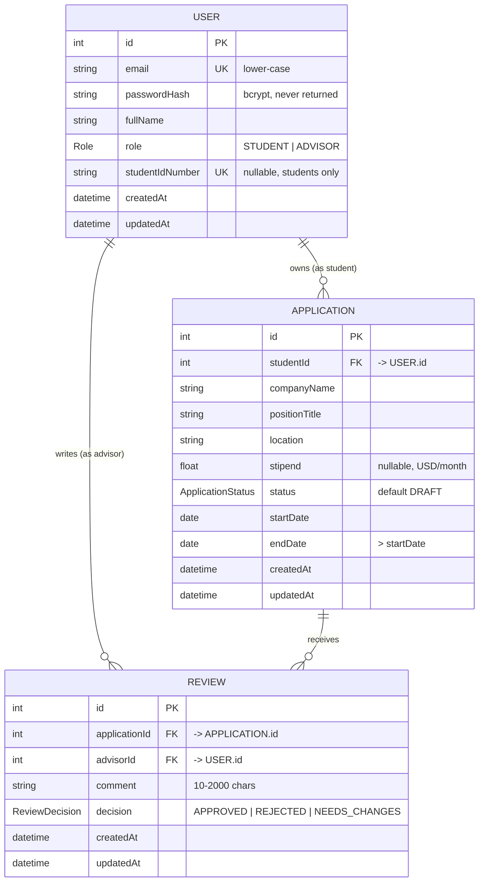
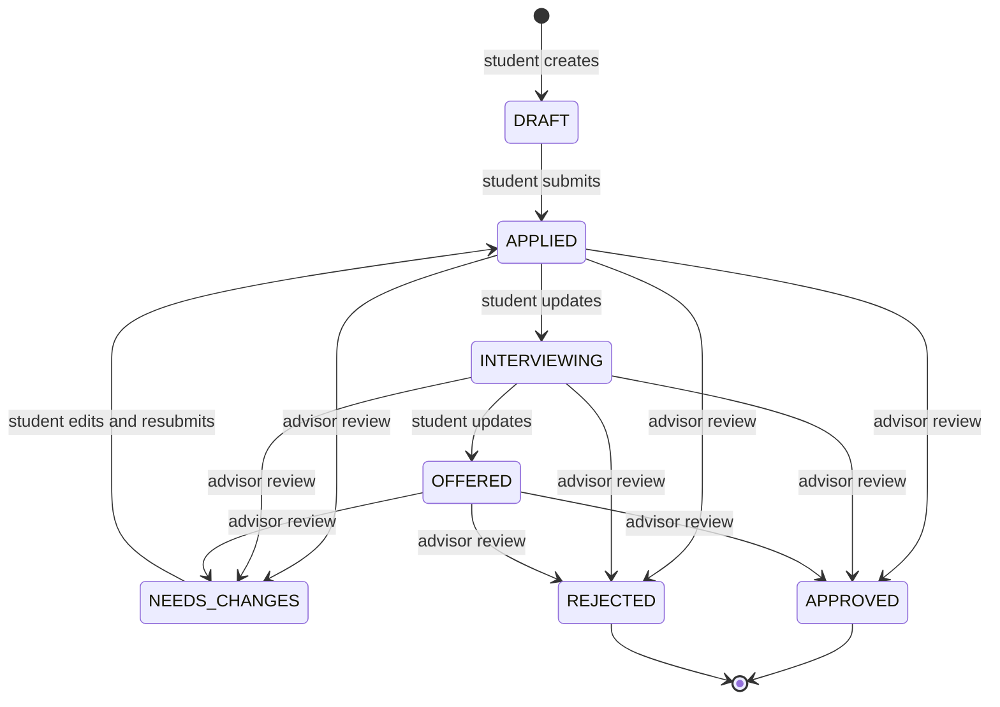

# Entity-Relationship Diagram

Student Internship Tracker — PostgreSQL schema managed by Prisma. Endpoints that use these tables: see
[`API.md`](API.md).

## Relations

| Relation | Cardinality | Foreign key | On delete | Why |
|---|---|---|---|---|
| User → Application | 1 : N | `Application.studentId` → `User.id` | `RESTRICT` | A student logs many applications; each one belongs to exactly one student, which is what the ownership (IDOR) check compares against. |
| Application → Review | 1 : N | `Review.applicationId` → `Application.id` | `RESTRICT` | An application can be reviewed several times (`NEEDS_CHANGES`, then `APPROVED`), giving a thread. `RESTRICT` backs the API rule "cannot delete an application with reviews" at the database level. |
| User → Review | 1 : N | `Review.advisorId` → `User.id` | `RESTRICT` | Each review has one author; keeping the advisor row keeps the audit trail intact. |

There is no direct N : N relation. Advisors and applications are many-to-many **through** `Review`: an advisor reviews
many applications, and an application can be reviewed by more than one advisor. `Review` carries its own data
(`comment`, `decision`, `createdAt`), so it is a real entity rather than a plain join table.

The role of the user on each side is not enforced by a foreign key (both point at `User`). The service layer checks it:
only a `STUDENT` can be `studentId`, only an `ADVISOR` can be `advisorId`.

## Enums

| Enum | Values |
|---|---|
| `Role` | `STUDENT`, `ADVISOR` |
| `ApplicationStatus` | `DRAFT`, `APPLIED`, `INTERVIEWING`, `OFFERED`, `NEEDS_CHANGES`, `APPROVED`, `REJECTED` |
| `ReviewDecision` | `NEEDS_CHANGES`, `APPROVED`, `REJECTED` |

`ReviewDecision` is a subset of `ApplicationStatus`: posting a review copies `decision` into `Application.status` in the
same transaction.

## Constraints and indexes

| Table | Constraint / index | Purpose |
|---|---|---|
| `User` | `UNIQUE (email)` | One account per email; duplicate register → `400` |
| `User` | `UNIQUE (studentIdNumber)` (nulls allowed) | One account per student ID; advisors have `NULL` |
| `Application` | `INDEX (studentId, updatedAt)` | Student's own list, newest first |
| `Application` | `INDEX (status)` | Status filter on the advisor list |
| `Application` | `CHECK (endDate > startDate)` | Added in the migration SQL as a second line of defence behind the DTO check |
| `Application` | `CHECK (stipend IS NULL OR stipend >= 0)` | Same |
| `Review` | `INDEX (applicationId, createdAt)` | Review thread, oldest first |
| `Review` | `INDEX (advisorId)` | Foreign-key lookups |

Search (`ILIKE` on `companyName` / `positionTitle`) runs without an index; with ≤ 1,000 rows (NFR-PERF-01) a sequential
scan is fast enough.

## Status lifecycle

A student may also move backwards between `DRAFT`, `APPLIED`, `INTERVIEWING` and `OFFERED` (for example to fix a
mistake); those arrows are left out to keep the diagram readable.
