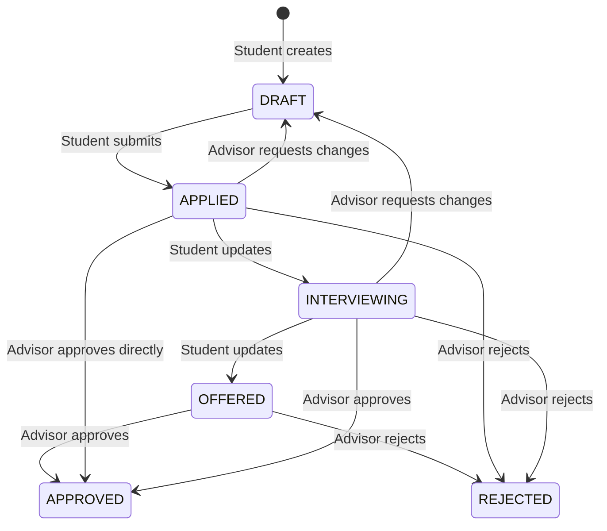

# Software Requirements Specification (SRS)

## Topic: Student Internship Tracker
- **Institution**: Institute of Technology of Cambodia (ITC)
- **Course**: Internet Programming I
- **Group**: I4-GIC-B
- **Student**: SOK Vireak (`e20231270`)
- **Lecturer**: Mr. CHUN Thavorac
- **Academic Year**: 2025–2026

---

## 1. Introduction

### 1.1 Purpose
This document defines the system requirements for the **Student Internship Tracker**, a full-stack web application that enables university students to record, manage, and monitor their internship applications, and allows faculty academic advisors to review, comment on, and officially approve or reject those applications for academic credit.

### 1.2 Scope
The Student Internship Tracker provides the following high-level capabilities:
- **For Students**: Register an account, log internship applications (company, position, dates, stipend), track application status through a defined lifecycle (`DRAFT` → `APPLIED` → `INTERVIEWING` → `OFFERED` → `APPROVED` / `REJECTED`), and view advisor feedback.
- **For Advisors**: Browse all student applications across the department, post review comments, and issue formal decisions (`PENDING`, `NEEDS_CHANGES`, `APPROVED`, or `REJECTED`) that update application status.

The system does **not** cover:
- Direct communication with external companies or job boards.
- Resume/CV file uploads or document management.
- Notifications via email or SMS (out of scope for this course).

### 1.3 Definitions & Acronyms
| Term | Definition |
| :--- | :--- |
| **SRS** | Software Requirements Specification |
| **JWT** | JSON Web Token — a compact, URL-safe token for stateless authentication |
| **RBAC** | Role-Based Access Control |
| **CRUD** | Create, Read, Update, Delete |
| **IDOR** | Insecure Direct Object Reference — a vulnerability where a user accesses another user's resource by manipulating an ID |
| **DTO** | Data Transfer Object — a class defining the shape and validation rules of API request/response payloads |
| **ORM** | Object-Relational Mapping |

---

## 2. Overall Description

### 2.1 Product Perspective
The Student Internship Tracker is a standalone, self-contained web application consisting of three tiers:
```
[ Vue 3 SPA (Frontend) ] ──REST API / HTTP/JSON──▶ [ NestJS (Backend) ] ──Prisma ORM / SQL──▶ [ PostgreSQL (Database) ]
```

### 2.2 User Classes & Characteristics
| User Class | Description | Technical Proficiency |
| :--- | :--- | :--- |
| **Student** | Undergraduate or graduate student tracking internship applications. Primary user who creates and manages application records. | Basic — comfortable using web forms and dashboards. |
| **Advisor** | Faculty member or academic coordinator responsible for reviewing and approving student internships for credit. | Basic — familiar with table views, filtering, and commenting workflows. |

### 2.3 Operating Environment
| Component | Technology |
| :--- | :--- |
| **Frontend** | Vue 3 + Vite + TypeScript, Pinia (state), Vue Router |
| **Backend** | NestJS 11 (Node.js), TypeScript |
| **Database** | PostgreSQL (latest stable) |
| **ORM** | Prisma |
| **Runtime** | Node.js ≥ 18 |
| **Browser Support** | Latest versions of Chrome, Firefox, Edge |

### 2.4 Design & Implementation Constraints
- All source code must be written in TypeScript.
- Backend architecture must follow NestJS modular conventions (`Module` → `Controller` → `Service` → `DTO`).
- Database schema changes must be managed exclusively through Prisma migrations (no raw DDL).
- Authentication must be stateless using JWT; no server-side sessions.
- Environment secrets (`JWT_SECRET`, `DATABASE_URL`) must be stored in `.env` files excluded from version control.

---

## 3. System Features & Functional Requirements

### 3.1 Authentication & Account Management
| ID | Requirement |
| :--- | :--- |
| **FR-AUTH-01** | The system shall allow a new user to register with email, password, fullName, and role (`STUDENT` or `ADVISOR`). |
| **FR-AUTH-02** | The system shall enforce email uniqueness; duplicate registration attempts shall return HTTP 400. |
| **FR-AUTH-03** | The system shall hash passwords using bcrypt before storing them. Raw passwords shall never be persisted or returned in any API response. |
| **FR-AUTH-04** | The system shall authenticate users via email and password and return a signed JWT on success (HTTP 200). |
| **FR-AUTH-05** | The system shall return HTTP 401 with a generic "Invalid credentials" message for incorrect email or password (no indication of which field is wrong). |

### 3.2 Internship Application Management (Main Entity — Full CRUD)
| ID | Requirement |
| :--- | :--- |
| **FR-APP-01** | A student shall be able to create a new internship application with: `companyName`, `positionTitle`, `location`, `stipend` (optional), `startDate`, `endDate`, and `status`. |
| **FR-APP-02** | The system shall default status to `DRAFT` on creation. |
| **FR-APP-03** | A student shall be able to view a paginated list of their own applications. |
| **FR-APP-04** | An advisor shall be able to view a paginated list of all student applications. |
| **FR-APP-05** | Both students and advisors shall be able to search applications by `companyName` or `positionTitle` (case-insensitive partial match). |
| **FR-APP-06** | Both students and advisors shall be able to filter the application list by status. |
| **FR-APP-07** | A student shall be able to update their own application details, provided the application status is not `APPROVED`. |
| **FR-APP-08** | A student shall be able to delete their own application only if it is in `DRAFT` or `APPLIED` status and has no associated advisor reviews. |
| **FR-APP-09** | Pagination shall default to 5 items per page and return `totalItems`, `totalPages`, and `currentPage` in the response metadata. |

### 3.3 Advisor Review & Approval
| ID | Requirement |
| :--- | :--- |
| **FR-REV-01** | An advisor shall be able to create a review for any student's application, providing a comment and a decision (`PENDING`, `NEEDS_CHANGES`, `APPROVED`, `REJECTED`). |
| **FR-REV-02** | When a review with decision `APPROVED` is submitted, the parent application's status shall be atomically updated to `APPROVED` within the same database transaction. |
| **FR-REV-03** | When a review with decision `REJECTED` is submitted, the parent application's status shall be atomically updated to `REJECTED`. |
| **FR-REV-04** | Reviews shall be displayed chronologically (oldest first) beneath the application detail view, forming a feedback thread. |
| **FR-REV-05** | Only users with the `ADVISOR` role may create reviews; `STUDENT` attempts shall return HTTP 403 Forbidden. |

---

## 4. External Interface Requirements

### 4.1 User Interface (UI)
The frontend is a Vue 3 Single Page Application (SPA).
| Screen | Route | Description |
| :--- | :--- | :--- |
| **Login / Register** | `/login`, `/register` | Tabbed or separate forms for authentication with role selection toggle. |
| **Student Dashboard** | `/dashboard` | Summary statistics (counts by status) and the filterable, searchable, paginated applications table. |
| **Create Application** | `/applications/new` | Form with validated fields (`companyName`, `positionTitle`, `location`, date pickers, optional stipend). |
| **Application Detail** | `/applications/:id` | Read-only or editable view of application fields, plus chronological advisor review thread. Advisors see a review submission form. |
| **Edit Application** | `/applications/:id/edit` | Pre-populated form for updating an existing application. |
| **404 Not Found** | `/:catchAll(.*)` | Custom fallback page for unmatched routes. |

### 4.2 Software Interfaces (REST API)
All protected endpoints require an `Authorization: Bearer <token>` header.
| Method | Endpoint | Description | Auth |
| :--- | :--- | :--- | :--- |
| `POST` | `/auth/register` | Register a new user | Public |
| `POST` | `/auth/login` | Authenticate and receive JWT | Public |
| `GET` | `/applications` | List applications (filtered, searched, paginated) | `STUDENT`, `ADVISOR` |
| `POST` | `/applications` | Create a new application | `STUDENT` |
| `GET` | `/applications/:id` | Get application detail with reviews | `STUDENT` (own), `ADVISOR` |
| `PATCH` | `/applications/:id` | Update an application | `STUDENT` (own) |
| `DELETE` | `/applications/:id` | Delete a draft application | `STUDENT` (own) |
| `POST` | `/applications/:id/reviews` | Submit an advisor review | `ADVISOR` |

### 4.3 Hardware & Communication Interfaces
- Standard web application protocol: HTTP/HTTPS
- Data format: JSON (`Content-Type: application/json`)
- CORS: Backend allows requests from the frontend origin (`http://localhost:5173` during development).

---

## 5. Non-Functional Requirements

### 5.1 Performance
- **NFR-PERF-01**: API responses for list endpoints (with pagination) shall return within 500 ms under normal load (single concurrent user, ≤ 1,000 records).
- **NFR-PERF-02**: Frontend page transitions (via Vue Router) shall render within 300 ms on a modern browser.

### 5.2 Security
- **NFR-SEC-01**: Passwords shall be hashed with bcrypt (minimum 10 salt rounds).
- **NFR-SEC-02**: JWT tokens shall be signed with HS256 using a secret loaded from the `JWT_SECRET` environment variable (minimum 32 characters).
- **NFR-SEC-03**: API responses shall never include `passwordHash` or any credential-related fields.
- **NFR-SEC-04**: IDOR shall be mitigated: a student requesting another student's resource shall receive HTTP 404 Not Found (not 403), preventing resource existence disclosure.
- **NFR-SEC-05**: All user inputs shall be validated at the backend using `class-validator` decorators on DTOs before reaching the service layer.

### 5.3 Reliability & Availability
- **NFR-REL-01**: Database schema changes shall be applied exclusively through versioned Prisma migrations, ensuring reproducible state.
- **NFR-REL-02**: A seed script (`prisma/seed.ts`) shall populate the database with demo data (at least 2 users and 5 applications) for development and review.

### 5.4 Maintainability
- **NFR-MAINT-01**: Backend code shall follow NestJS modular architecture: one module per domain entity (`AuthModule`, `ApplicationModule`, `ReviewModule`).
- **NFR-MAINT-02**: Frontend components shall follow the Vue 3 Composition API with `<script setup lang="ts">` syntax.
- **NFR-MAINT-03**: All architectural decisions shall be recorded in `DECISIONS.md` with date, context, and rationale.

### 5.5 Testability
- **NFR-TEST-01**: Frontend components shall have unit tests using Vitest covering at least form validation and conditional rendering logic.
- **NFR-TEST-02**: Backend API shall have end-to-end tests using Jest + Supertest covering: successful CRUD, validation errors (400), unauthorized access (401), forbidden actions (403), and IDOR prevention (404).

---

## 6. Data Model & Database Design

### 6.1 Entity-Relationship Overview
```
USER ──(1:N)──▶ APPLICATION ──(1:N)──▶ REVIEW ◀──(N:1)── USER
```

### 6.2 Entity: User
| Field | Type | Constraints | Description |
| :--- | :--- | :--- | :--- |
| `id` | Int | PK, Auto-increment | Unique identifier |
| `email` | String | Unique, Not Null | Login email address |
| `passwordHash` | String | Not Null | bcrypt-hashed password |
| `fullName` | String | Not Null, Min 2 chars | Display name |
| `role` | Enum | `STUDENT` \| `ADVISOR` | Access control role |
| `studentIdNumber` | String | Nullable | University student ID (students only) |
| `createdAt` | DateTime | Default: `now()` | Account creation timestamp |

### 6.3 Entity: Application (Main Entity)
| Field | Type | Constraints | Description |
| :--- | :--- | :--- | :--- |
| `id` | Int | PK, Auto-increment | Unique identifier |
| `studentId` | Int | FK → User.id, Not Null | Owning student |
| `companyName` | String | Not Null, Min 2 chars | Company name |
| `positionTitle` | String | Not Null, Min 2 chars | Internship position title |
| `location` | String | Not Null | Office location or "Remote" |
| `stipend` | Float | Nullable | Monthly stipend amount (USD) |
| `status` | Enum | Default: `DRAFT` | `DRAFT` \| `APPLIED` \| `INTERVIEWING` \| `OFFERED` \| `APPROVED` \| `REJECTED` |
| `startDate` | DateTime | Not Null | Internship start date |
| `endDate` | DateTime | Not Null, > startDate | Internship end date |
| `createdAt` | DateTime | Default: `now()` | Record creation timestamp |
| `updatedAt` | DateTime | Auto-update | Last modification timestamp |

### 6.4 Entity: Review
| Field | Type | Constraints | Description |
| :--- | :--- | :--- | :--- |
| `id` | Int | PK, Auto-increment | Unique identifier |
| `applicationId` | Int | FK → Application.id, Not Null | Reviewed application |
| `advisorId` | Int | FK → User.id, Not Null | Reviewing advisor |
| `comment` | String | Not Null, Min 10 chars | Advisor feedback text |
| `decision` | Enum | Not Null | `PENDING` \| `NEEDS_CHANGES` \| `APPROVED` \| `REJECTED` |
| `createdAt` | DateTime | Default: `now()` | Review submission timestamp |

### 6.5 Relationship Summary
- **User → Application**: One-to-Many (`1:N`). A student creates many applications; each application belongs to one student.
- **User → Review**: One-to-Many (`1:N`). An advisor writes many reviews; each review is authored by one advisor.
- **Application → Review**: One-to-Many (`1:N`). An application may receive many reviews; each review belongs to one application.

### 6.6 Status Lifecycle


---

## 7. User Stories & Acceptance Criteria

### Story 1: User Registration
As a university member, I want to register an account with my email, password, full name, and role, so that I can access the internship tracker with appropriate permissions.
- **AC-1.1**: Email must be valid format and unique; duplicate returns HTTP 400 with "Email already registered".
- **AC-1.2**: Password must be ≥ 8 characters, containing at least one letter and one digit.
- **AC-1.3**: fullName is required and must be ≥ 2 characters.
- **AC-1.4**: role must be either `STUDENT` or `ADVISOR`; invalid values return HTTP 400.
- **AC-1.5**: Successful registration returns HTTP 201 with user profile (excluding passwordHash).

### Story 2: User Login
As a registered user, I want to log in with my email and password, so that I receive a JWT token to access protected features.
- **AC-2.1**: Valid credentials return HTTP 200 with `{ accessToken, user: { id, email, role, fullName } }`.
- **AC-2.2**: Invalid credentials return HTTP 401 with "Invalid credentials".
- **AC-2.3**: Token is stored in Pinia auth store and attached as `Authorization: Bearer <token>` on all subsequent requests.

### Story 3: Create Internship Application
As a student, I want to create a new internship application record, so that I can track my application progress and share it with my advisor.
- **AC-3.1**: `companyName` (≥ 2 chars) and `positionTitle` (≥ 2 chars) are required; missing fields return HTTP 400.
- **AC-3.2**: `startDate` must be before `endDate`; violation displays "End date must be after start date".
- **AC-3.3**: status defaults to `DRAFT` if not provided.
- **AC-3.4**: Successful creation returns HTTP 201 and redirects the student to the detail page.
- **AC-3.5**: Only `STUDENT` role can create; `ADVISOR` attempts return HTTP 403.

### Story 4: View Applications with Search, Filter & Pagination
As a student or advisor, I want to browse a paginated list of applications with search and status filter, so that I can quickly find specific applications.
- **AC-4.1**: Students see only their own applications; Advisors see all applications.
- **AC-4.2**: Status filter dropdown immediately filters the displayed list.
- **AC-4.3**: Search input matches case-insensitively against `companyName` or `positionTitle`.
- **AC-4.4**: Response includes `totalItems`, `totalPages`, `currentPage`; default page size is 5.

### Story 5: Update Application Details
As a student, I want to edit an existing internship application, so that my records reflect the latest information.
- **AC-5.1**: Only the owning student can edit; others receive HTTP 404.
- **AC-5.2**: Applications with status `APPROVED` are locked and cannot be edited (HTTP 403 with "Approved applications cannot be modified").
- **AC-5.3**: Valid updates return HTTP 200 with the updated record.

### Story 6: Delete Application
As a student, I want to delete an unwanted draft application, so that my tracker stays clean and organized.
- **AC-6.1**: Only applications in `DRAFT` or `APPLIED` status with zero reviews can be deleted.
- **AC-6.2**: Deletion of reviewed or approved applications returns HTTP 403 with "Cannot delete application with existing reviews".
- **AC-6.3**: Successful deletion returns HTTP 204 No Content.

### Story 7: Advisor Review & Decision
As an academic advisor, I want to post a review with comments and a formal decision on a student's application, so that the student receives academic feedback and approval status.
- **AC-7.1**: Only `ADVISOR` role can create reviews; `STUDENT` attempts return HTTP 403.
- **AC-7.2**: comment is required (≥ 10 characters); empty or short comments return HTTP 400.
- **AC-7.3**: decision must be one of: `PENDING`, `NEEDS_CHANGES`, `APPROVED`, `REJECTED`.
- **AC-7.4**: If decision is `APPROVED` or `REJECTED`, the parent application status is updated atomically in a database transaction.
- **AC-7.5**: Successful review creation returns HTTP 201.

### Story 8: Access Control & IDOR Prevention
As a system user, I want to have the system enforce strict access boundaries, so that student data privacy is protected.
- **AC-8.1**: Unauthenticated requests to protected endpoints return HTTP 401.
- **AC-8.2**: Student A requesting Student B's application via `/applications/:id` receives HTTP 404 (not 403).
- **AC-8.3**: Frontend router guards redirect unauthenticated users to `/login`.
- **AC-8.4**: Frontend router guards redirect users accessing role-restricted pages to `/dashboard` with a toast message.

---

## 8. Security Requirements

### 8.1 Authentication
- Passwords are hashed using bcrypt with a minimum cost factor of 10.
- Authentication tokens are JWT (HS256) with 24 hours expiration.
- The signing secret (`JWT_SECRET`) is loaded from environment variables and is ≥ 32 characters.

### 8.2 Authorization & Access Control Matrix
| Resource Action | STUDENT | ADVISOR | Violation Response |
| :--- | :--- | :--- | :--- |
| **Register / Login** | ✓ | ✓ | — |
| **Create Application** | ✓ (own) | ✗ | 403 Forbidden |
| **Read Application** | ✓ (own) | ✓ (all) | 404 Not Found (IDOR mitigated) |
| **Update Application** | ✓ (own, not APPROVED) | ✗ | 404 (IDOR) / 403 (approved) |
| **Delete Application** | ✓ (own, DRAFT/APPLIED, no reviews) | ✗ | 404 (IDOR) / 403 (has reviews or status) |
| **Create Review** | ✗ | ✓ | 403 Forbidden |

### 8.3 Data Protection
- `passwordHash` is excluded from all API response serialization.
- SQL injection is prevented by using Prisma's parameterized queries exclusively.
- All input is sanitized and validated with class-validator DTO decorators.
